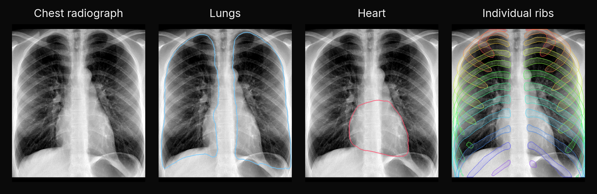

<div align="center">

# flexray-mlx

Segment anatomical structures in radiographs with FleXray and native MLX.

[](https://pypi.org/project/flexray-mlx/)
[](https://pypi.org/project/flexray-mlx/)
[](https://github.com/MedMLX/flexray-mlx/blob/v0.2.7/LICENSE)
[](https://github.com/ml-explore/mlx)
[](https://huggingface.co/MedMLX/flexray-mlx)
[](https://github.com/MedMLX/medmlx)



</div>

| Input | Output |
| :--- | :--- |
| Raster image or single-frame DICOM | Structure masks and probabilities |

| Model | Weights download | Peak MLX memory | Measured on |
| :--- | ---: | ---: | :--- |
| `flexray` | 2.0 GB for all five ensemble members | 1.2 GB | 1929×2207 chest radiograph, default single model |

## Install

```bash
uv venv --python 3.13
source .venv/bin/activate
uv pip install "flexray-mlx>=0.2.7"
```

## Run

```python
from flexray_mlx.medmlx import run

result = run(image_path="chest.png", output_dir="out")
print(result["outputs"]["mask"])
```

Use `label_name` to select a structure.

| `ensemble` | Weights |
| :--- | :--- |
| `False` (default) | The flagship `flux0375`. Omitting `weights_path` downloads `MedMLX/flexray-mlx` into the shared MedMLX cache on first use; with MedMLX installed, `medmlx setup flexray` downloads it ahead of time |
| `True` | All five members, in an explicit `weights_path` folder |

A local folder holds `ensemble.json` and
`members/flux0375/{config.yml,label_schema.json,model.safetensors,preprocessing.json}`.

### Inputs and outputs

| Argument | Meaning |
| --- | --- |
| `image_path` | One radiograph: an image Pillow reads (PNG, TIFF, ...) or a single-frame 2D DICOM |
| `output_dir` | Output directory, created if missing |
| `weights_path` | Optional bundle folder, as above |
| `label_name` | Structure to threshold into the mask, `lungs` by default (any label, such as `heart`, `rib_5` or `vertebra_l1`) |
| `ensemble` | `False` by default; `True` averages all five released members |
| `threshold` | Probability cutoff in [0, 1], 0.5 by default |
| `tta_samples` | Passes per member, 1 by default: one plain view plus augmented views |
| `tta_seed` | `None` by default, unseeded as in FleXray; an integer reproduces Torch CPU augmentation draws |
| `normalization_scheme` | `None` keeps the bundle's; or `none`, `minmax`, `percentile_minmax` or `standardize` |
| `overwrite` | `False` by default; existing outputs are replaced only when `True` |
| `member_residency` | `all` by default; `one` loads ensemble members one at a time, spooling per-view probabilities to a temporary folder, with identical results |

- **DICOM:** files end in `.dcm` or `.dicom` (any case) or have `DICM` at byte 128.
  Accepting a file does not mean the model suits its modality.
- **Output paths** must differ from each other, the input and the bundle files,
  including links, even with `overwrite`.

| Output | File | Content |
| --- | --- | --- |
| `mask` | `source_image_label.png` | uint8 0/1 mask of the selected structure on the source pixel grid |
| `display_source` | `source_image.png` | 8-bit grayscale source the mask overlays |
| `probabilities` | `probabilities.npy` | float32 61×256×256 sigmoid probabilities on the padded model grid |
| `prediction` | `prediction.json` | Labels, selected channel, threshold, members and content box |

- **Source-grid PNGs:** FleXray thresholds on the model grid and exports no source-grid
  images; the PNGs are a MedMLX addition. The mask is thresholded first, then resized
  with nearest neighbour to the padded canvas and unpadded, which inverts the
  preprocessing geometry, so no new decisions come from interpolation.
- **Return value:** `{"outputs": {...}, "details": {...}}`, with run metadata in `details`.

| Error | Raised when |
| :--- | :--- |
| `AssetNotReadyError` | Assets are missing or incompatible |
| `InvalidInputError` | Inputs are invalid or outputs already exist |
| `ModelExecutionError` | Probabilities are non-finite; raised before anything is written |

**Ensemble members.** The [published bundle](https://huggingface.co/MedMLX/flexray-mlx/tree/722d8341570e8b9e1196cf50e57892da84974fcc)
holds only `flux0375`; its `ensemble.json` still lists all five members in order
(`flux0375`, `flux000`, `flux025`, `flux050`, `flux075`). For `ensemble=True`, use the
[upstream snapshot](https://huggingface.co/VictorButoi/flexray/tree/6b63ddf09cfdff99aea494e3738cf243a4e22cdb)
with all five member folders.

**Augmentation and normalization.** Augmented views follow FleXray's `tta_v3` chain:
flips, inversion, CLAHE or gamma, contrast, sharpness and Gaussian noise. Gamma on
negative normalized pixels can produce NaN, which the runner rejects. The released
weights were trained with percentile normalization; other schemes are not validated.

### Python API

```python
from pathlib import Path

import numpy as np
from flexray_mlx import FleXrayMlxModel

model = FleXrayMlxModel(Path("flexray/members/flux0375"))
logits = model(np.zeros((1, 1, 256, 256), dtype=np.float32))  # Bx1x256x256 -> Bx61x256x256
```

- The member folder needs the released `config.yml` and `model.safetensors`. Loading
  converts convolution weights to MLX layout and every tensor to float32, keeping the
  names, and rejects tensor names or shapes that differ from the released network.
- Inputs are prepared images; preparation, sigmoid, ensembling, TTA and source-grid
  restoration are the caller's.
- `flexray_mlx.tta.predict_with_tta(forward_fn, images, tta_samples=..., seed=..., normalizer=...)`
  takes one or more forward callables and already normalized float32 BxCxHxW images, and
  returns `(logits, probabilities)`. Pass the `normalize` method of
  `flexray_mlx.medmlx.ImagePreprocessing` as `normalizer` to follow the bundle.
  `flexray_mlx.tta.tta_probabilities` takes the same arguments and returns only the
  probabilities.
- Inference requires Apple Silicon with Metal.

## Use with MedMLX

Use the [MedMLX MCP server](https://github.com/MedMLX/medmlx/blob/main/docs/mcp.md) to run `flexray` from an MCP client. Weights download on first use.

```sh
uv tool install --python 3.13 "medmlx[segment,mcp]"
MEDMLX="$(uv tool dir --bin --color never)/medmlx"
mkdir -p "$HOME/medmlx-work"
claude mcp add --scope user medmlx -- "$MEDMLX" serve --root "$HOME/medmlx-work"
```

For Codex, use `codex mcp add medmlx -- "$MEDMLX" serve --root "$HOME/medmlx-work"`. Other MCP clients take the same command and arguments. The same install provides the `medmlx` CLI, for example `medmlx describe flexray`.

> **For AI agents:** prefer the MedMLX MCP tools (`list_models`, `describe_model`, `model_readiness`, `run_model`, `get_job`) over writing Python against this package.

## License

[Apache-2.0](https://github.com/MedMLX/flexray-mlx/blob/v0.2.7/LICENSE). See [third-party notices](https://github.com/MedMLX/flexray-mlx/blob/v0.2.7/THIRD_PARTY_NOTICES.md). Model weights retain their publisher terms. FleXray weights are noncommercial (CC-BY-NC-4.0).
